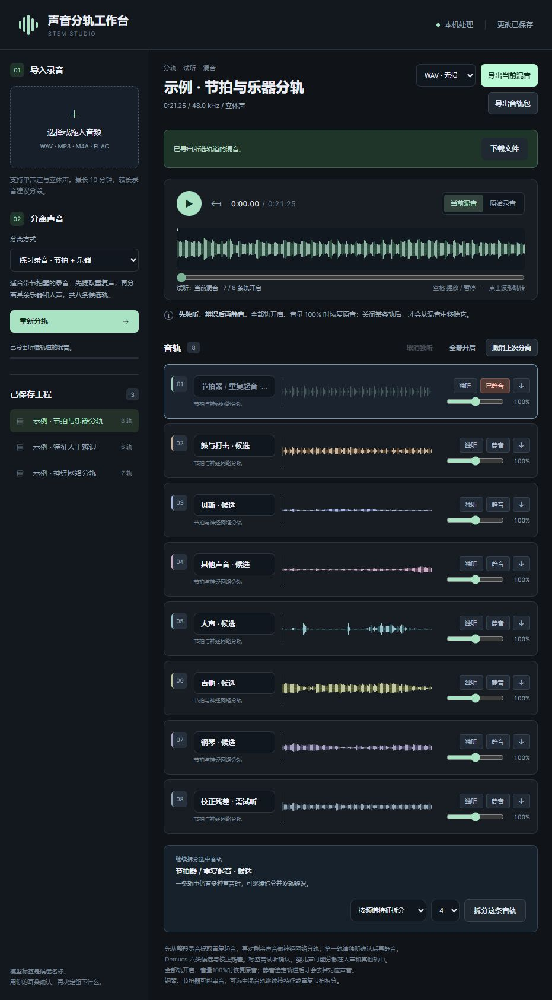

# Reusable Audio Multitrack Workstation

**声音分轨工作台：导入录音，逐轨试听，选择保留的声音，再导出混音。**

适合钢琴练习录音、音乐分轨和人工辨识声音。使用 Demucs 神经网络、重复节拍提取与 NMF 频谱特征拆分，所有音频处理都在本机完成。

[快速开始](#快速开始) · [使用教程](#使用教程) · [常见问题](#常见问题) · [下载源码 ZIP](https://github.com/ayyyeeeee/Reusable-Audio-Multitrack-Workstation/archive/refs/heads/main.zip)



## 功能

- 导入 WAV、M4A、MP3、FLAC 等单声道或立体声录音。
- 神经网络分轨；对混杂音轨继续按声学特征或重复节拍拆分。
- 同步试听、逐轨独听、静音、音量调整、人工命名和原音对比。
- 自动保存工程，撤销上次分离，下次继续编辑。
- 导出 WAV / FLAC / MP3 混音，或下载独立音轨 ZIP。

## 快速开始

以下步骤面向 **Windows + Python 3.12（64 位）**。当前推理使用 CPU，不需要独立显卡。

### 1. 准备环境与源码

安装 [Python 3.12](https://www.python.org/downloads/) 和 [FFmpeg](https://ffmpeg.org/download.html)。将 FFmpeg 的 `bin` 文件夹加入系统 PATH，重新打开终端，确认这两条命令可运行：

```powershell
ffmpeg -version
ffprobe -version
```

下载上方 ZIP 并解压，或使用 Git：

```powershell
git clone https://github.com/ayyyeeeee/Reusable-Audio-Multitrack-Workstation.git
cd Reusable-Audio-Multitrack-Workstation
```

后续命令都在项目文件夹内运行。

### 2. 安装依赖与模型

使用独立虚拟环境，无需修改 PowerShell 执行策略或手动激活环境：

```powershell
py -3.12 -m venv .venv
.\.venv\Scripts\python.exe -m pip install --upgrade pip
.\.venv\Scripts\python.exe -m pip install torch==2.7.1 torchaudio==2.7.1 --index-url https://download.pytorch.org/whl/cpu
.\.venv\Scripts\python.exe -m pip install -r requirements.txt -r requirements-studio.txt
.\.venv\Scripts\python.exe tools/setup_demucs.py
```

首次安装需要联网下载依赖及约 **52.4 MiB** 的官方模型。模型下载后保存在 `models/demucs/`，后续分轨可离线运行。只有特征拆分时，可只安装 `requirements.txt`。

### 3. 启动

双击 **`启动系统.bat`**，或运行：

```powershell
.\.venv\Scripts\python.exe studio.py
```

浏览器会打开 **http://127.0.0.1:8765**。保留启动窗口，关闭窗口或按 `Ctrl+C` 会停止服务。

## 使用教程

以“钢琴 + 节拍器 + 婴儿声”的练习录音为例：

1. **导入录音**：点击左上角选择文件，也可以拖入音频。
2. **选择分离方式**：有连续节拍器时，先选“练习录音 · 节拍 + 乐器”，再点击分轨。
3. **逐轨独听**：点击每条音轨的“独听”，按实际听到的声音改名，例如“节拍器”“钢琴主体”“婴儿声混合”。
4. **继续拆分**：一条轨仍有多个声音时，选中它，在下方选择“按频谱特征拆分”或“按重复节拍拆分”；分错可撤销。
5. **关闭不需要的声音**：将相应轨静音，取消独听，播放当前混音并切换原始录音比较。
6. **保存音频**：右上角选择 WAV / FLAC / MP3，再点击“导出当前混音”和“下载文件”。需要在其他软件继续编辑，可导出音轨包。

**先听，再命名，再静音。** 模型给出的名称只是候选标签：钢琴可能进入“吉他”或“其他”轨，婴儿声也可能分散在人声等多条轨里。

| 分离方式 | 适用情况 | 输出 |
| --- | --- | --- |
| 神经网络 · 六类音轨 | 普通音乐或没有稳定重复声的录音 | 鼓、贝斯、其他、人声、吉他、钢琴候选 + 校正残差，共 7 轨 |
| 练习录音 · 节拍 + 乐器 | 带重复节拍器的练习录音 | 先提取重复起音，再进行神经分轨，共 8 轨 |
| 频谱特征 · 人工辨识 | 希望按声音特征分组，或进一步拆开混合轨 | 2–8 条待人工辨识的候选轨 |

工程自动保存在 `音轨工程/`。导出生成新文件，不覆盖输入。独听是临时选择，导出当前混音时也会生效；导出前请确认已取消不需要的独听。

## 常见问题

**分轨后为什么听起来仍像原音？**  
全部音轨开启、音量为 100% 时会重建原音。分轨完成后，需要将不想保留的候选轨静音。

**能把婴儿、节拍器和钢琴完全分干净吗？**  
目前不能保证。婴儿声和节拍器不是 Demucs 的独立训练类别；与钢琴起音重叠时可能串音或损伤音色。建议独听确认，再尝试继续拆分。[Demucs 官方也说明六源模型的钢琴轨存在串音和伪影](https://github.com/facebookresearch/demucs#separating-tracks)。

**提示没有可靠的重复节拍？**  
改选“神经网络 · 六类音轨”或“频谱特征 · 人工辨识”。重复钢琴起音也可能被当成节拍候选，需要试听确认。

**提示缺少模型或依赖？**  
重新执行上面的安装步骤，并使用 `.venv` 中的 Python。模型校验失败时，移走报错的模型文件，再运行 `tools/setup_demucs.py` 重新下载。

**文件多长、数据放在哪里？**  
当前最长 10 分钟，上传上限 256 MiB，解码后不超过 180 MiB；内存不足时请分段处理。最多保留 32 条当前音轨。音频与工程仅保存在本机，仓库不附带个人录音、已保存工程或模型权重。

## 开发与验证

```powershell
.\.venv\Scripts\python.exe -W error::ResourceWarning -m unittest discover -s tests -v
node --check stemstudio/web/app.js
node tests/test_frontend_mix.cjs
```

Node.js 仅用于前端测试，日常运行不需要。测试使用合成音频；未安装模型时对应的真实推理测试会跳过。功能测试和全轨重建检查不能代表真实录音的分离音质。

```text
studio.py              启动入口
stemstudio/            分轨、工程管理、混音与本地网页
clickremover/          音频读写、重复事件处理及旧版兼容模块
tools/setup_demucs.py  下载官方模型
models/demucs/         模型来源、校验值与第三方许可证
tests/                 音频处理和混音测试
```

## 致谢

神经网络基于 [Demucs / HTDemucs](https://github.com/facebookresearch/demucs)，遵循其 MIT 许可证，模型信息见 [MODEL_CARD](models/demucs/MODEL_CARD.md)。教程组织参考 [Demucs](https://github.com/facebookresearch/demucs) 和 [Ultimate Vocal Remover](https://github.com/Anjok07/ultimatevocalremovergui) 的项目说明，文字按本项目实际功能编写。
